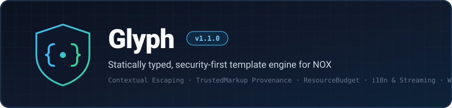

<div align="center">



<br />

[](https://github.com/mburakmmm/glyph/actions/workflows/ci.yml)
[](https://github.com/mburakmmm/glyph/actions/workflows/release.yml)
[](https://github.com/mburakmmm/nox-lang)
[](#cross-platform-ci--targets)
[](SECURITY.md)
[](LICENSE)

<p>
  <a href="#quick-start">Quick Start</a> •
  <a href="#security--output-profiles">Security Model</a> •
  <a href="#cli-tooling">CLI</a> •
  <a href="#framework-adapters">Nyx &amp; Aether</a> •
  <a href="#roadmap">Roadmap</a> •
  <a href="docs/api.md">API Docs</a>
</p>

</div>

---

> **Current Release (`v0.7.0`, Phases 0–9 Complete):** Core engine, contextual HTML/URL/JS escaping, 50+ pure filters/tests, i18n catalogs & plural rules, 6 output profiles, streaming `GlyphWriter`, opt-in **Nyx** & **Aether** adapters, and the `glyph` CLI verified with **14/14 passing test suites** (`noxc test`) on LLVM, QBE, `--profile freestanding`, and `wasm32-freestanding`. Next milestone: [Phase 10 — `v1.0.0` Production Hardening & Release Gate](todo.md).

---

## Why Glyph?

NOX's stdlib `nox.template` is a lightweight placeholder utility. **Glyph** is an independent, full-featured template engine inspired by Jinja2 ergonomics while enforcing NOX's static typing, ahead-of-time compilation, and strict capability boundaries:

| Guarantee | What Glyph Enforces |
|---|---|
| **Data, Not Code** | No NOX/Python code execution, `eval`, `exec`, dynamic `import`, reflection (`__class__`, `__dict__`, `constructor`, `prototype`), or arbitrary I/O inside templates. |
| **Fail-Closed Contextual Escaping** | `HtmlContextTracker` tracks HTML text, quoted attributes, URL attributes (`href`/`src`/`action`/`srcset`), `<script>` (`|tojson` `SafeJs`), `<style>`, comments, and branch/include state divergence. |
| **Context-Tagged Trust Provenance** | `TrustedMarkup` (`SafeHtml`, `SafeAttr`, `SafeUrl`, `SafeJs`) never cross-promotes implicitly across contexts and is stripped upon untrusted string concatenation or `TrustTier.Restricted`. |
| **Non-Resettable Resource Budgets** | Shared `ResourceBudget` bounds source bytes, token count, AST nodes, expression/include/macro depth, loop iterations, output bytes (16 MiB default), and total operations. |
| **Path-Confined Loaders & Isolated Cache** | `FilesystemLoader` locks resolution to a canonical root (anti-traversal/symlink/sibling escape). `CompileCache` isolates keys by `origin_id`, source fingerprint, mode, autoescape, trust tier, registry generations, catalog version, and locale. |
| **Portable & Zero External Dependencies** | Core `glyph/api.nox` compiles cleanly under `--profile freestanding` and `--target wasm32-freestanding`. Hosted features (`loader_fs.nox`, `locale.nox`, `cli/`) remain cleanly separated. |

---

## Quick Start

### 1. Render Safely in NOX (`import glyph.api`)

```nox
import glyph.api
from glyph.api import MemoryLoader, Environment, Template, Context

loader: MemoryLoader = MemoryLoader()
loader.put("pages/hello.html", "<h1>Welcome, {{ user.name }}</h1><a href=\"{{ user.site }}\">Home</a>")

env: Environment = glyph.api.default_environment(loader)
tpl: Template = glyph.api.get_template("pages/hello.html", env)
ctx: Context = glyph.api.context_from_json('{"user":{"name":"<Ada>","site":"https://nox-lang.dev"}}')

html: str = glyph.api.render(tpl, ctx, env)
# => <h1>Welcome, &lt;Ada&gt;</h1><a href="https://nox-lang.dev">Home</a>
```

Unsafe URLs (e.g. `javascript:alert(1)`, `java&#115;cript:`, `%73` smuggling), unquoted attributes, inline `on*` handlers, `<style>`/`style=`, `srcdoc`, or raw `<script>` interpolations fail closed with `GlyphSecurityError`. Use `{{ data | tojson }}` for `<script>` JSON payloads.

### 2. CLI Tooling (`cli/main.nox`)

```sh
# Build the standalone CLI executable
noxc build -o glyph-cli cli/main.nox

# Compile-check, lint, inspect AST metadata, trace transitive dependencies, and render with JSON context
./glyph-cli check --root ./templates pages/hello.html
./glyph-cli lint --root ./templates --format json pages/hello.html
./glyph-cli inspect --root ./templates --format json pages/hello.html
./glyph-cli deps --root ./templates --format json pages/hello.html
./glyph-cli render --root ./templates --context-json '{"user":{"name":"<Ada>","site":"https://nox-lang.dev"}}' pages/hello.html
./glyph-cli bench --root ./templates --iterations 100 --format json pages/hello.html
```

Exit codes are deterministic: `0` OK, `2` usage, `3` syntax, `4` loader, `5` security, `6` resource limit, `7` runtime/type, `8` internal.

---

## Security & Output Profiles

| Output Profile | Escaping & Security Contract |
|---|---|
| `OutputMode.Html` *(default)* | Contextual state machine, URL allowlist (`http`, `https`, `mailto`, `tel`, single-`/` relative), `SafeJs`-only `<script>` (`\|tojson`), fail-closed `Unknown` |
| `OutputMode.Text` | Unescaped plain text with full `ResourceBudget`, `TrustTier`, reflection, and helper bounds active |
| `OutputMode.Xml` | Entity escaping, XML 1.0 illegal control byte rejection, dynamic tag/attribute & unquoted attribute denial, comment breakout guards |
| `OutputMode.Markdown` | Literal Markdown generation with explicit `\|md_escape` helper (downstream Markdown→HTML sanitization stays an explicit host boundary) |
| `OutputMode.Json` | Safe JSON scalar/collection/string serialization (`nox.json.dump_string`) and `SafeJs` preservation |
| `OutputMode.EmailSubject` | Single-line header protection rejecting `\r`, `\n`, and `NUL` in both static templates and context values (`render_email_pair` helper in `glyph/email.nox`) |

---

## Architecture & Dependency Direction

```text
           Application / Nyx / Aether / CLI / WASM Host
                                |
                    optional adapters (integrations/)
                                |
       +------------------- glyph.api -------------------+
       |            Environment / Template               |
       |  Loader + Registry + Cache + Catalog + Options  |
       +------------------------+------------------------+
                                |
                +---------------+------------------+
                |                                  |
         compile pipeline                     render pipeline
  lexer -> parser -> AST -> validate       AST interpreter -> Writer
                |                                  |
                +-------- Expression IR -----------+
                                |
          Value + Scope + Safety/Escaping + Limits + Errors
                                |
              verified NOX stdlib capabilities
```

- **Strict Isolation (`AGENTS.md` §2.18):** `glyph/*` never imports `integrations/`, `nyx`, `aether`, or `aura`. Only hosted opt-in modules (`loader_fs.nox`, `locale.nox`) may import `nox.fs` or `nox.unicode`. Enforced automatically on every CI run.

---

## Framework Adapters

- **Nyx (`integrations/nyx/glyph_nyx.nox`):** Opt-in `render_view(...)` and preflight `render_view_stream(...)` managing `Content-Type`, `X-Content-Type-Options: nosniff`, `Cache-Control`, and validated single-line `Content-Security-Policy` nonces without touching `nyx.view.render`. See [docs/integration-nyx.md](docs/integration-nyx.md).
- **Aether (`integrations/aether/glyph_aether.nox`):** Explicit HTTP `Accept` content-negotiation across `text/html`, `application/xml`, and `text/plain` (directing `application/json` payloads to `nox.json`). See [docs/integration-aether.md](docs/integration-aether.md).

---

## Cross-Platform CI & Targets

Verified against **`noxc 2.1.186`** across:

| Target | Runner | Backends & Verification |
|---|---|---|
| **Linux x86_64** | `ubuntu-latest` | LLVM, QBE, `--strict-spawn-shared`, CLI build, 14/14 `noxc test`, examples, SBOM |
| **Linux ARM64** | `ubuntu-24.04-arm` | LLVM, QBE, `--strict-spawn-shared`, CLI build, 14/14 `noxc test`, examples |
| **macOS ARM64** | `macos-latest` | LLVM, QBE, `--strict-spawn-shared`, CLI build, 14/14 `noxc test`, examples |
| **Windows x86_64** | `windows-latest` | LLVM, QBE, `--strict-spawn-shared`, CLI build, 14/14 `noxc test`, examples |
| **WebAssembly** | `wasm32-freestanding` | `noxc build --target wasm32-freestanding` on `glyph/api.nox` & `audit_consumer` |

```sh
# Local verification commands
noxc check --profile freestanding glyph/api.nox
noxc test
noxc run examples/hello/main.nox
noxc run examples/blog_layout/main.nox
noxc run examples/email/main.nox
noxc run examples/nyx/main.nox
noxc run examples/aether/main.nox
noxc sbom . -o glyph.sbom.json
noxc sign check .
```

---

## Roadmap

| Phase | Tag | Scope Summary | Status |
|---|---|---|---|
| **Phase 0** | `v0.0.1-audit` | Toolchain lock (`noxc 2.1.186`), capability matrix, PoCs, CI/Release, `ADR-0001` | Done |
| **Phase 1** | `v0.0.2-core-lexer` | Typed `Value`, `SourceSpan`, `GlyphError`, `ResourceBudget`, O(n) `Lexer` | Done |
| **Phase 2** | `v0.0.3-parser-ast` | `ADR-0002`, Pratt expression parser, AST, `if`/`for`/`set`, static validation | Done |
| **Phase 3** | `v0.1.0` **(MVP)** | Interpreter, chunked `Writer`, HTML escape, MVP filters, `MemoryLoader` | Done |
| **Phase 4** | `v0.2.0` | `ADR-0005`, `ADR-0007`, `FilesystemLoader` sandbox, `include`, `CompileCache` | Done |
| **Phase 5** | `v0.3.0` | `ADR-0006`, `extends`, `block`, `super()`, `macro`, `import`, `call/caller` | Done |
| **Phase 6** | `v0.4.0` | `ADR-0003`, `ADR-0004`, `ADR-0012`, contextual HTML/URL/JS escaping, XSS gate | Done |
| **Phase 7** | `v0.5.0` | 50+ pure filters/tests, `FilterSpec`/`TestSpec`, `HelperContext`, registry lock | Done |
| **Phase 8** | `v0.6.0` | `ADR-0008`, `ADR-0009`, i18n/plural, XML/MD/JSON/Email modes, streaming `Writer` | Done |
| **Phase 9** | `v0.7.0` | `ADR-0010`, `integrations/nyx`, `integrations/aether`, `glyph` CLI, diagnostics | Done |
| **Phase 10** | `v1.0.0` **(STABLE)** | Fuzzing, property/differential/concurrency tests, benchmarks, Release Gate | Planned |
| **Phase 11** | `v1.1.0+` / `v2.0` | `with`/`filter` blocks, component/slot DSL, const-folding, LSP, AOT research | Planned |

---

## Documentation Hub

| Document | Topic |
|---|---|
| [AGENTS.md](AGENTS.md) | Binding engineering specification, security invariants & architecture contract |
| [todo.md](todo.md) / [docs/roadmap.md](docs/roadmap.md) | Detailed phase-by-phase task & milestone tracker |
| [docs/api.md](docs/api.md) | Public NOX API, CLI subcommands, and adapter surface |
| [docs/syntax.md](docs/syntax.md) · [docs/expressions.md](docs/expressions.md) | Template statements, safe expression grammar & truthiness |
| [docs/security.md](docs/security.md) · [SECURITY.md](SECURITY.md) | Contextual XSS defense, `TrustedMarkup` rules & vulnerability disclosure |
| [docs/filters.md](docs/filters.md) | Full built-in filter/test signatures, cost classes & expansion caps |
| [docs/loaders.md](docs/loaders.md) | Canonical root confinement, `ChoiceLoader`/`PrefixLoader` & cache keys |
| [docs/integration-nyx.md](docs/integration-nyx.md) · [docs/integration-aether.md](docs/integration-aether.md) | Nyx SSR & Aether HTTP adapter guides |
| [docs/compatibility.md](docs/compatibility.md) | Verified `noxc 2.1.186` stdlib & compiler capability matrix |
| [docs/adr/](docs/adr/) | Architecture Decision Records (`ADR-0001` – `ADR-0012`) |
| [CONTRIBUTING.md](CONTRIBUTING.md) · [CHANGELOG.md](CHANGELOG.md) | Contribution workflow & version history |

---

## License

MIT — see [LICENSE](LICENSE).
